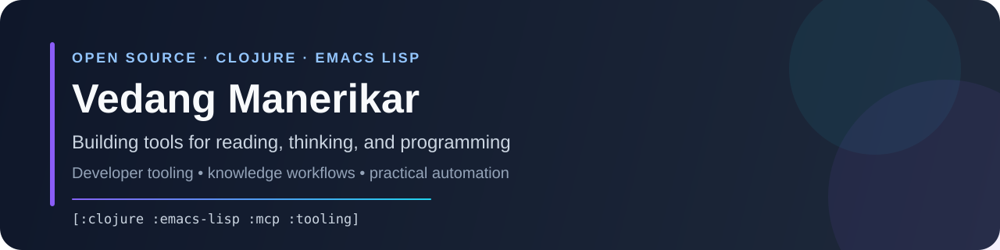

  

# Hi, I'm Vedang 👋

I like building practical tools for developers and knowledge workers. A lot of my open-source work lives at the intersection of **Emacs**, **Clojure**, **knowledge workflows**, and **developer ergonomics**. More recently, I've been exploring **agent-oriented tooling**.

**Current**: [Unravel.tech](https://unravel.tech) · **Alum:** [Recurse Center](https://www.recurse.com/) · **Previously:** [Helpshift](https://www.helpshift.com/)

## Featured work

### Agent tooling & practical automation

- 🤖 **[dotagents](https://github.com/vedang/dotagents)** — My agent harness configuration, extensions, skills, and workflow setup. [Setup guides](https://vedang.me/dotagents/). `⭐ 13`
- 🔎 **[pi-exa](https://github.com/vedang/pi-exa)** — Web search and page content extraction through Exa, inside Pi.
- 📚 **[pi-load-skill](https://github.com/vedang/pi-load-skill)** — Load skills on demand from a palette instead of adding them all to the initial context.
- 📐 **[pi-adr](https://github.com/unravel-team/pi-adr)** — Create and maintain Architecture Decision Records with Pi.
- 📊 **[pi-opentelemetry](https://github.com/vedang/pi-opentelemetry)** — Opt-in OpenTelemetry logs, metrics, and traces for Pi sessions.

### Emacs & knowledge workflows

- 📄 **[pdf-tools](https://github.com/vedang/pdf-tools)** — Emacs support library for PDF files. `⭐ 851`
- 🎨 **[alabaster-themes](https://github.com/vedang/alabaster-themes)** — Minimal light and dark GNU Emacs themes inspired by the original Alabaster palette. `⭐ 34`
- ⚙️ **[unravel-team/emacs](https://github.com/unravel-team/emacs)** — GNU Emacs configuration for Emacs 30 and above. `⭐ 16`
- 📝 **[denote-publish](https://github.com/vedang/denote-publish)** — Publish Denote notes to Markdown while keeping front matter intact. `⭐ 1`

### Clojure libraries & backend tooling

- 🔌 **[mcp-clojure-sdk](https://github.com/unravel-team/mcp-clojure-sdk)** — A Clojure SDK for creating MCP servers (and eventually clients). `⭐ 65`
- 🗃️ **[clj_fdb](https://github.com/vedang/clj_fdb)** — Thin Clojure wrapper around the Java FoundationDB API. `⭐ 28`
- 🧠 **[cljc-fsrs](https://github.com/open-spaced-repetition/cljc-fsrs)** — Clojure(Script) implementation of FSRS v4 for spaced repetition. `⭐ 17`
- 🪵 **[clj-logging](https://github.com/vedang/clj-logging)** — Template project showing how to wire Log4J2 cleanly across transitive dependencies. `⭐ 7`
- 📐 **[metaprogramming](https://github.com/unravel-team/metaprogramming)** — Cross-language metaprogramming conventions and Makefile templates for Clojure, Go, Python, and TypeScript projects. `⭐ 2`
- 🌐 **[litellm-clj](https://github.com/unravel-team/litellm-clj)** — A shared Clojure API for multiple language model providers, with streaming and model routing. `⭐ 52`
- 🧩 **[DSCloj](https://github.com/unravel-team/DSCloj)** — Define and optimize language model pipelines in Clojure, inspired by DSPy. `⭐ 42`

<strong>Unmaintained projects that I'm proud of</strong>

<ul>
  <li>🎨 <strong><a href="https://github.com/vedang/pi-antigravity-image-gen">pi-antigravity-image-gen</a></strong> — Generate images in Pi through Google Antigravity and Vertex AI. <code>⭐ 0</code></li>
  <li>💬 <strong><a href="https://github.com/vedang/pi-btw">pi-btw</a></strong> — Ask read-only side questions without adding them to the main Pi conversation. <code>⭐ 0</code></li>
  <li>🌊 <strong><a href="https://github.com/vedang/pi-custom-provider-deepseek">pi-custom-provider-deepseek</a></strong> — Use DeepSeek models in Pi with support for its thinking controls. <code>⭐ 0</code></li>
  <li>🌙 <strong><a href="https://github.com/vedang/pi-custom-provider-kimi">pi-custom-provider-kimi</a></strong> — Use selected Kimi models in Pi through the Kimi API. <code>⭐ 0</code></li>
  <li>🟢 <strong><a href="https://github.com/vedang/pi-custom-provider-nvidia">pi-custom-provider-nvidia</a></strong> — Use a curated set of NVIDIA NIM models in Pi. <code>⭐ 0</code></li>
  <li>🧠 <strong><a href="https://github.com/vedang/pi-custom-provider-zai">pi-custom-provider-zai</a></strong> — Use ZAI-family models hosted by ZAI and Cerebras in Pi. <code>⭐ 2</code></li>
  <li>📝 <strong><a href="https://github.com/vedang/pi-learn-stuff">pi-learn-stuff</a></strong> — Capture reusable lessons from Pi sessions in <code>AGENTS.md</code> files. <code>⭐ 0</code></li>
  <li>📊 <strong><a href="https://github.com/vedang/pi-progress-bar">pi-progress-bar</a></strong> — Show a passive task board and progress widget with Jev-backed assessments in Pi. <code>⭐ 0</code></li>
  <li>🔎 <strong><a href="https://github.com/vedang/pi-prompt-history">pi-prompt-history</a></strong> — Search past Pi prompts with a Ctrl-R overlay. <code>⭐ 5</code></li>
  <li>🧩 <strong><a href="https://github.com/vedang/pi-quizme">pi-quizme</a></strong> — Quiz your understanding of recent Pi session changes and grade your answers. <code>⭐ 0</code></li>
  <li>🔁 <strong><a href="https://github.com/vedang/pi-ralph-loop">pi-ralph-loop</a></strong> — Run autonomous planning loops in Pi with progress saved between iterations. <code>⭐ 0</code></li>
  <li>🔬 <strong><a href="https://github.com/vedang/pi-review-code">pi-review-code</a></strong> — Build context-rich review prompts and review code in an isolated Pi conversation branch. <code>⭐ 0</code></li>
  <li>🧹 <strong><a href="https://github.com/vedang/pi-simplify-code">pi-simplify-code</a></strong> — Ask Pi to simplify recently changed code automatically or on demand. <code>⭐ 0</code></li>
  <li>👀 <strong><a href="https://github.com/vedang/pi-watcher">pi-watcher</a></strong> — Turn marked editor comments into focused prompts in the active Pi session. <code>⭐ 2</code></li>
  <li>🌱 <strong><a href="https://github.com/vedang/bloomclj">bloomclj</a></strong> — Bloom filter implementation in Clojure. <code>⭐ 20</code></li>
  <li>🧹<strong><a href="https://github.com/vedang/nginx-nonewlines">nginx-nonewlines</a></strong> — Nginx module that strips newline characters from served HTML. <code>⭐ 18</code></li>
  <li>🐍<strong><a href="https://github.com/vedang/python-emacs">python-emacs</a></strong> — Emacs setup and third-party packages for a stronger Python workflow. <code>⭐ 11</code></li>
  <li>👷<strong><a href="https://github.com/vedang/emacs-up">emacs-up</a></strong> — My long-running personal Emacs configuration. <code>⭐ 33</code></li>
  <li>🗂️ <strong><a href="https://github.com/vedang/org-mode-crate">org-mode-crate</a></strong> — Plug-and-play Org Mode configuration built from a real day-to-day workflow. <code>⭐ 24</code></li>
  <li>🔧 <strong><a href="https://github.com/vedang/bb-scripts">bb-scripts</a></strong> — A collection of Babashka scripts for day-to-day automation. <code>⭐ 12</code></li>
  <li>📚 <strong><a href="https://github.com/vedang/csaoid">csaoid</a></strong> — Cheat sheets and other interesting documents I keep reaching for. <code>⭐ 21</code></li>
</ul>

## Connect

- 🌐 Website: [vedang.me](https://vedang.me/)
- 🐦 X: [@vedang](https://x.com/vedang)
- 🐘 Masto: [@vedang](https://fosstodon.org/@vedang)
- 💻 GitHub: [github.com/vedang](https://github.com/vedang)
